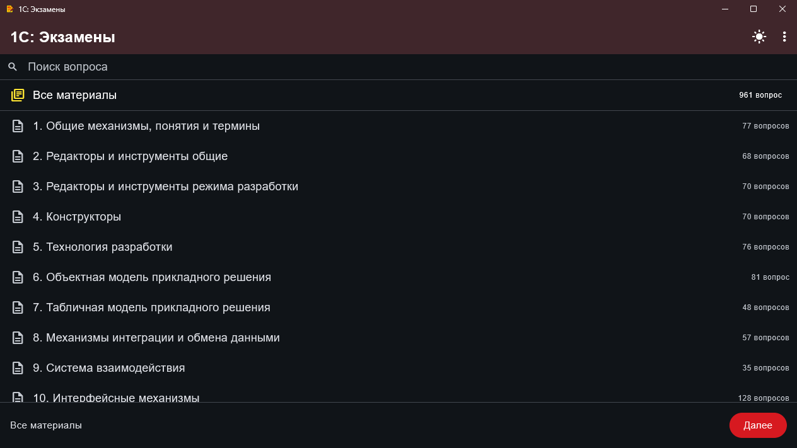

# 1С: Экзамены

Приложение для подготовки к экзамену «1С:Профессионал по платформе». Flutter-клиент выпускается для **Windows** и **Android**. Вопросы сгруппированы по темам; в приложении есть поиск по вопросам, выбор материалов и переход к решению.

> Публичный репозиторий содержит только опубликованные сборки. Исходный код приложения хранится отдельно.

## Скриншоты

### Windows

Скриншот сделан на Windows из опубликованной сборки **v1.0.33**. Экран показывает список доступных материалов и строку поиска.

_Скриншот Android будет добавлен после успешного запуска приложения на Android-устройстве или эмуляторе._

## Скачать

Откройте [страницу релизов](https://github.com/ultraslide/1C_ExamAppReleases/releases) и выберите сборку для своей платформы. Для последней версии скачивайте APK или архив Windows из последнего стабильного релиза.

Перед установкой сверяйте SHA-256 файла с контрольной суммой, указанной в описании релиза.

### Windows

Скачайте ZIP-архив Windows x64, распакуйте его в отдельную папку и запустите `flutter_exam_app.exe`.

### Android

Скачайте универсальный APK и установите его на устройство Android. В релизах может публиковаться тестовая APK-сборка, подписанная Android Debug; её подпись и ограничения всегда проверяйте в описании конкретного релиза. APK с другой подписью нельзя установить как обновление поверх уже установленной версии — может потребоваться удалить старую сборку.

## Наборы вопросов

Наличие набора зависит от конкретной сборки: проверяйте описание релиза. Если в приложении нет встроенных материалов, поддерживается импорт ZIP-набора через интерфейс приложения.

## Важно

- APK с подписью Android Debug предназначен для тестирования, а не для публикации в Google Play.
- Перед установкой проверяйте версию, тип подписи и SHA-256 на странице выбранного релиза.
- Публичный репозиторий релизов не является репозиторием исходного кода.
